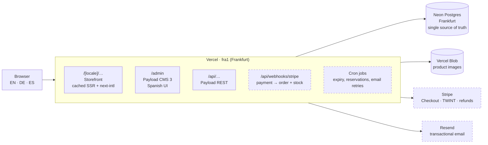
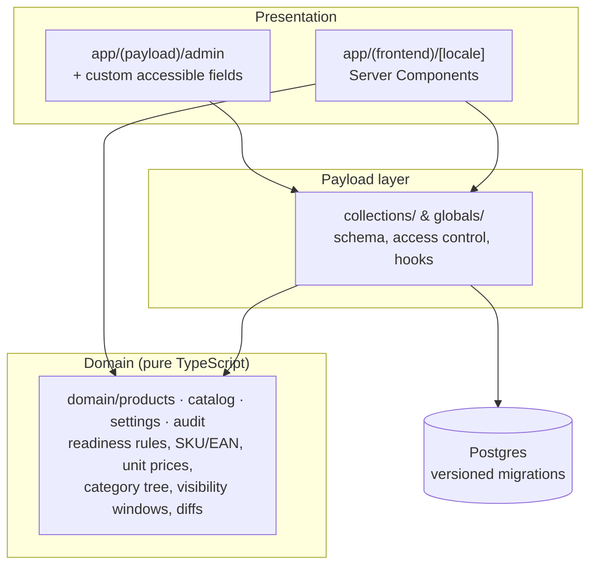
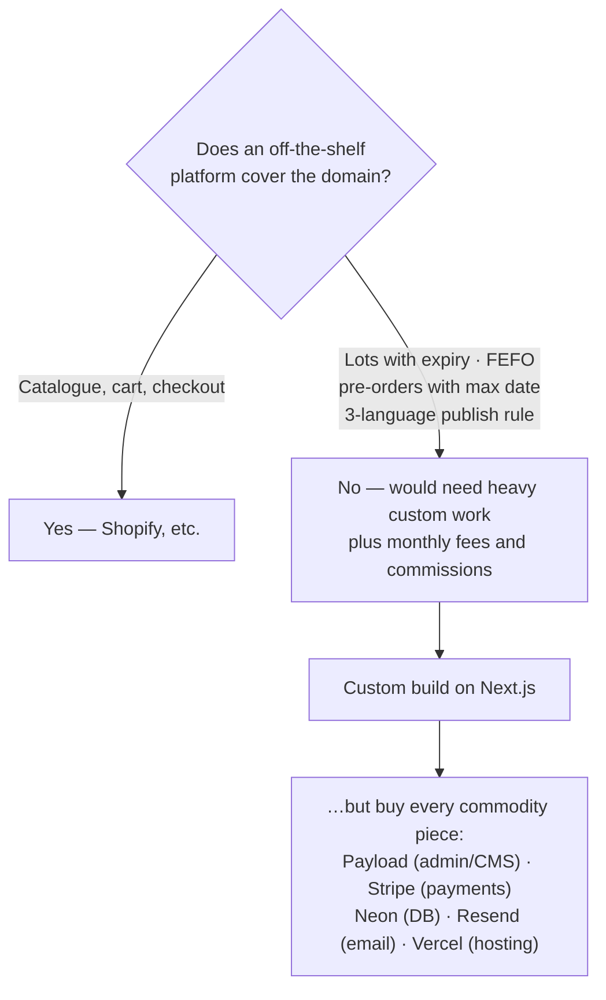
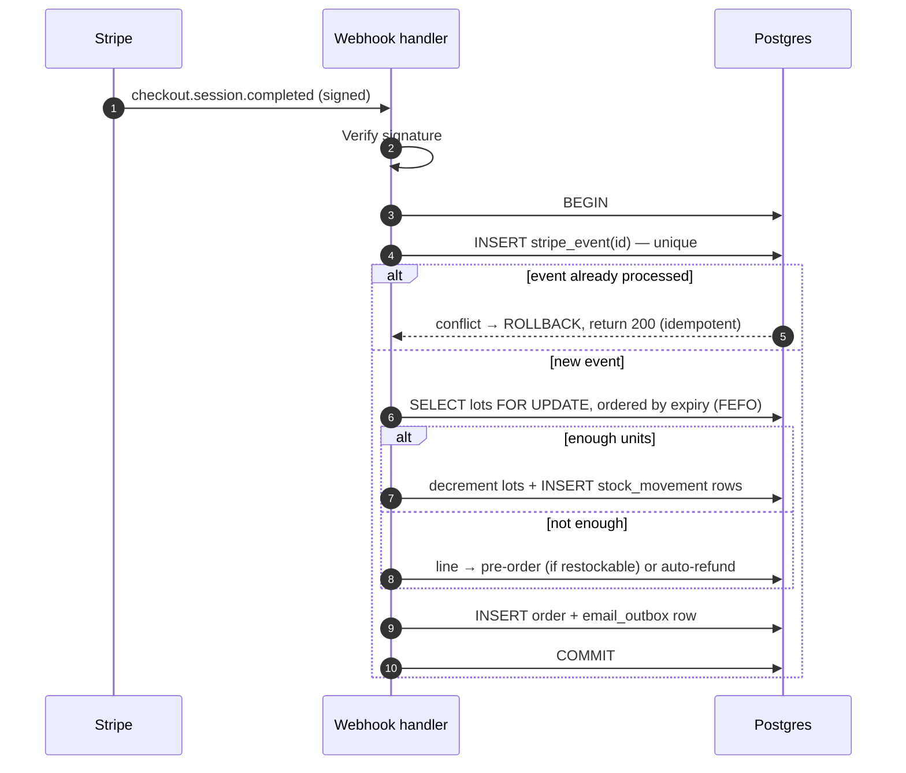
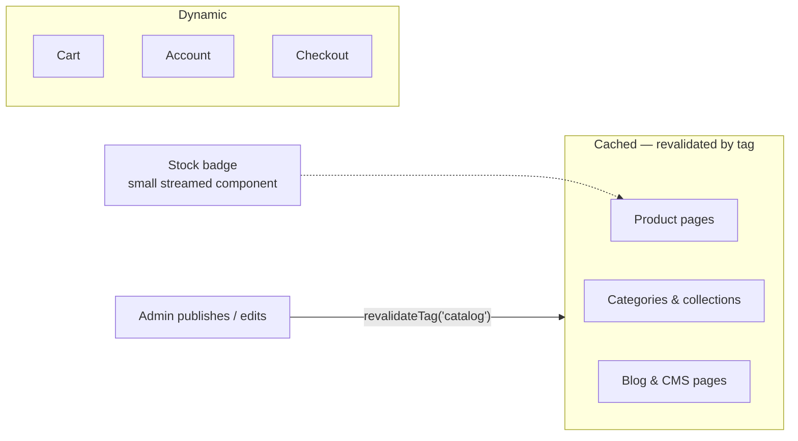
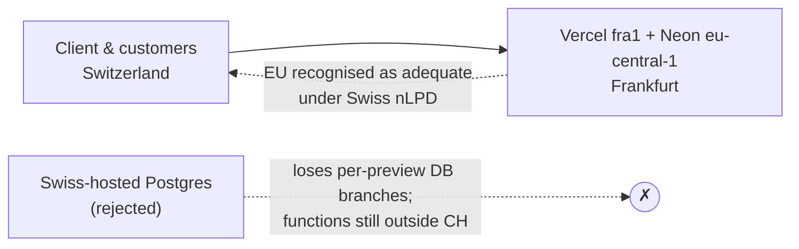
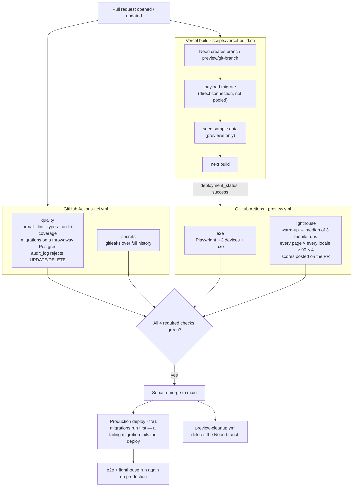
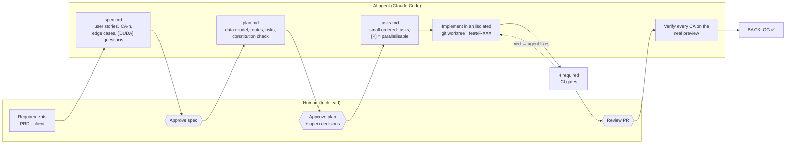

<div align="center">

# Sijôu

**A production e-commerce platform for a Swiss natural-cosmetics brand — built by one engineer working with an AI coding agent, under a spec-driven process with hard quality gates.**

Trilingual storefront (EN · DE · ES) · Spanish admin panel · Prices in CHF · Launch: 1 Feb 2027


-%E2%89%A590_%C3%97_4-f44b21?logo=lighthouse&logoColor=white)


</div>

---

## At a glance

| | |
|---|---|
| **What** | A custom online shop: catalogue with variants, lot-based stock with expiry dates (FEFO), pre-orders, promotions, Stripe Checkout with TWINT, CMS pages and a blog. |
| **Who** | One engineer, a real client, a fixed launch date. Claude Code as a pair programmer under strict human review. |
| **Why it's interesting** | Every PR must pass **Lighthouse ≥ 90 in all four categories on mobile, in all three languages**, zero axe accessibility violations, unit + E2E tests for every acceptance criterion, and secret scanning — against a **real Vercel preview with its own database branch**. Nothing merges otherwise. |
| **Progress** | 8 of ~45 features shipped (platform, i18n, design system, products, variants, categories, settings + audit log). See the [backlog](specs/BACKLOG.md). |
| **Numbers** | 30+ merged PRs · 136 unit tests · 28 E2E scenarios × 3 devices · 4 required CI checks · 3 locales audited per page |

---

## Table of contents

1. [Architecture](#architecture)
2. [Tech stack and why](#tech-stack-and-why)
3. [Key design decisions](#key-design-decisions)
4. [How it deploys](#how-it-deploys)
5. [Quality gates](#quality-gates)
6. [The agentic workflow](#the-agentic-workflow)
7. [Repository tour](#repository-tour)
8. [Running it locally](#running-it-locally)
9. [Documentation](#documentation)

---

## Architecture

One Next.js application holds everything — public shop, admin panel, API and webhooks — deployed to a single Vercel region next to its database. No microservices: for one developer and a fixed date, fewer moving parts beats theoretical scalability.



<sub>Dashed boxes are designed and specified, not built yet.</sub>

**Principles** (from [ARCHITECTURE.md](docs/ARCHITECTURE.md)):

1. **Buy before build** — as long as it doesn't block a requirement.
2. **Postgres is the only source of truth** for catalogue, stock, orders and content. **Stripe is the source of truth for money.**
3. **Static or cached SSR for the public site** (SEO and Core Web Vitals); dynamic rendering only for cart, account and checkout.
4. **Stock consistency lives in the database** — transactions and row locks, never the client.
5. **Data stays in Europe**, as close to Switzerland as the providers allow.

### Inside the app



Business rules live in `src/domain/` as framework-free functions with 100 % branch coverage. Payload collections call them from hooks and validators, so the same rule (for example *"a product can only be published when all three languages are complete"*) guards both the admin UI and the API.

---

## Tech stack and why

| Layer | Choice | Why this, and what was rejected |
|---|---|---|
| Framework | **Next.js 16** (App Router, Cache Components) · **React 19** | Server-rendered HTML for SEO, tag-based revalidation for a cached catalogue, one deployable for shop + admin + API. |
| Language | **TypeScript (strict)** · Node.js 24 LTS | Types generated from the Payload schema flow end to end. |
| Admin & CMS | **Payload CMS 3**, embedded in the same Next.js app | Localised fields, drafts, versions, media and access control out of the box — saves weeks of CRUD. *Rejected:* a hand-built admin (too risky for the date) and **Shopify headless** (no lot expiry, no pre-order queue, no "publish only when 3 languages are complete", plus monthly fees). |
| Database | **Neon Postgres** (Frankfurt) via Drizzle | Database **branch per preview deployment**; same region as the functions. Neon has no Swiss region — Switzerland recognises the EU as adequate under the nLPD, documented in the privacy policy. |
| Hosting | **Vercel**, pinned to `fra1` | Preview per PR, native Neon and Blob integrations, functions next to the DB. |
| i18n | **next-intl** | Translated URLs (`/es/productos/…`, `/de/produkte/…`), `hreflang` and canonicals from one route map. No hard-coded strings anywhere. |
| Styling | **Tailwind CSS 4** + native, accessible components | OKLCH colour ramps with AA/AAA contrast; no third-party JS on public pages without a measured justification. |
| Media | **Vercel Blob** + Payload/sharp WebP sizes | Direct uploads; images pre-sized at upload time. |
| Payments | **Stripe Checkout (embedded)** — *planned* | PCI SAQ A, TWINT, Apple Pay, Google Pay and localised UI with no extra code. |
| Auth | **Better Auth** — *planned* | Customer data stays in our own database, no per-user cost. *Rejected:* Clerk (US data processor, per-MAU pricing). |
| Email | **Resend + React Email**, outbox pattern — *planned* | The business transaction writes the email row; a retrying job sends it, so no email is lost if the provider is down. |
| Search | **Postgres FTS + `pg_trgm`** — *planned* | Typo-tolerant, per-language `tsvector`; no extra service for a small catalogue. |
| Testing | **Vitest** · **Playwright** + **axe-core** · **Lighthouse CI** | Unit for domain logic, E2E for every user story on mobile Chrome, mobile Safari and desktop Chrome. |

---

## Key design decisions

The full list is in the [ADRs](docs/ARCHITECTURE.md#3-decisiones-adr-resumidas). Four of them shape most of the code.

### 1. Build vs. buy



### 2. Stock integrity — the core of the domain

Units live in `lot` rows with expiry dates. Every change writes an append-only `stock_movement`. When Stripe confirms a payment, one database transaction does all of the work:



Why: Stripe retries webhooks, two customers can buy the last unit at the same moment, and an audit trail of stock is a business requirement. Row locks plus a unique event ID solve all three without a queue or a distributed lock. *(Specified in F-013/F-033; F-013 is the next feature in progress.)*

### 3. Rendering and caching



Catalogue pages are cached and invalidated by tag when the admin publishes. Stock is shown by a small streamed component, so a sale doesn't invalidate the whole page. Collections with a visibility window compute their own `cacheLife` from the next date they change (`nextVisibilityChange`).

### 4. Data residency



---

## How it deploys

Git is the only deploy mechanism. Every pull request gets a full, isolated environment — its own Vercel preview **and its own Neon database branch** — and the slow checks (E2E, Lighthouse) run against that real deployment, not a local build.



Details worth noting:

- **Migrations gate the release.** `vercel-build.sh` runs `payload migrate` before `next build`; if a migration fails, the deployment fails and production is untouched. Schema push is forbidden outside local dev.
- **Test data never reaches production.** The seed script refuses to run there; sample products only exist on preview branches.
- **Supply-chain hygiene.** pnpm only installs versions published at least **14 days** ago; every GitHub Action is pinned by commit SHA; Dependabot runs monthly with a cooldown and grouped updates.
- **Branch protection** on `main`: PR only, linear history, all four checks required, enforced for admins too ([setup](docs/github-setup.md)).

---

## Quality gates

These are written into the [constitution](specs/constitution.md) and enforced by CI — not aspirations.

| Gate | Threshold | Enforced by |
|---|---|---|
| Lighthouse (mobile) | **≥ 90** in Performance, Accessibility, Best Practices, SEO — target 100 — on every public template **in every locale** | `lighthouse` job on the preview, blocks merge |
| Performance budget | LCP < 2.5 s · INP < 200 ms · CLS < 0.1 · initial JS < 100 kB gzip per public route | Plan review + Lighthouse |
| Accessibility | WCAG 2.2 AA, AAA text contrast where possible, **zero axe violations** — admin panel included | axe in every Playwright test |
| Tests | Unit tests for all domain logic (**100 % branches** for stock, pricing, promotions, shipping); E2E for every user story; every acceptance criterion cited by ID (`it('CA-3: …')`) | `quality` + `e2e` jobs |
| i18n | No hard-coded user-facing strings; `hreflang` + canonical on every public page | Plan review + E2E |
| Domain integrity | Stock only changes inside transactions with a `stock_movement` row; webhooks idempotent and signature-verified; prices computed server-side | Plan review + tests |
| Security | No secrets in the (public) repo; server-side authorisation on every admin action; append-only audit log enforced by a DB trigger | `secrets` job · CI SQL check |

A concrete example of "fix it properly": several of Payload's built-in admin fields had axe violations. Rather than adding exceptions, the project ships accessible replacement fields (`src/components/admin/`), an accessible-name feature for the rich-text editor, and small upstream patches in `patches/`.

---

## The agentic workflow

This project is built with **Claude Code** as a coding agent. The interesting part is not that an AI writes code — it's the guardrails that make the output trustworthy enough to ship to a paying client.

### Spec-Driven Development

No production code is written without an approved **spec** (what and why) and **plan** (how). The human owns the *what* and every approval; the agent drafts, implements and verifies.



| Phase | Artifact | Exit gate |
|---|---|---|
| 1. Specify | [`spec.md`](specs/F-012-categorias-colecciones/spec.md) — stories, acceptance criteria `CA-n`, edge cases, out-of-scope | Approved, no open `[DUDA]` |
| 2. Plan | [`plan.md`](specs/F-012-categorias-colecciones/plan.md) — data model, routes, contracts, risks, [constitution](specs/constitution.md) check | Approved |
| 3. Tasks | [`tasks.md`](specs/F-012-categorias-colecciones/tasks.md) — each task linked to the CAs it covers | — |
| 4. Implement | Code + tests on `feat/F-XXX-slug`, one PR per feature | CI green, Lighthouse ≥ 90 × 4, axe clean |
| 5. Verify | Each CA checked on the preview; backlog updated | Feature marked *Done* |

### How the agent is kept honest

- **Rules as code.** [`CLAUDE.md`](CLAUDE.md) and the [constitution](specs/constitution.md) are loaded into every session: non-negotiables, language rules, "never commit secrets — the repo is public".
- **Machine-checkable acceptance criteria.** Every test cites the `CA-n` it proves, so "done" is a list of passing tests, not a claim.
- **The CI gates don't care who wrote the code.** Lighthouse, axe, E2E on a real deployment and gitleaks apply equally to human and agent commits.
- **Isolated worktrees.** Each feature runs in its own git worktree and branch; parallel sessions never touch the same files.
- **Questions instead of guesses.** Ambiguities become `[DUDA: …]` entries in the spec ([open questions log](specs/DUDAS.md)) or explicit decision points (D-1…D-n) in the plan for the human to resolve.
- **Persistent project memory.** Hand-off notes record infrastructure facts and hard-won gotchas (e.g. *"Vercel instances may serve a stale page for a few seconds after `revalidateTag`"*), so the next session doesn't relearn them.
- **Human approval for anything irreversible** — production data, deleting cloud resources, force-pushes.

Most commits on `main` carry a `Co-Authored-By: Claude` trailer; every one of them passed the same four gates.

---

## Repository tour

```
src/
├── app/
│   ├── (frontend)/[locale]/   Storefront: home, products, categories, collections, catalogue
│   └── (payload)/             Admin panel and REST API (Payload CMS)
├── collections/ · globals/    Payload schema, access control, hooks (Products, Variants, Categories…)
├── domain/                    Pure business rules + unit tests (products, catalog, settings, audit)
├── components/                ui/ (design system) · brand/ · admin/ (accessible custom fields)
├── i18n/ · lib/               Routing, translated slugs, cached navigation
└── migrations/                Versioned SQL migrations
messages/                      UI strings in en, de, es
e2e/                           Playwright specs (+ axe) per feature
specs/                         Constitution, backlog and one folder per feature (spec · plan · tasks)
docs/                          PRD, architecture & ADRs, brand, GitHub setup
scripts/                       Seed data and the Vercel build script
patches/                       Small upstream fixes (mostly accessibility) applied by pnpm
```

---

## Running it locally

Requirements: Node.js 24 (`.nvmrc`), pnpm via Corepack (`corepack enable`) and Docker (local Postgres).

```bash
docker compose up -d          # Postgres on localhost:54329
cp .env.example .env.local    # then set PAYLOAD_SECRET and SEED_ADMIN_PASSWORD
pnpm install
pnpm migrate && pnpm seed     # schema + test administrator
pnpm dev                      # shop at /en, /de, /es; admin panel at /admin (port 3100)
```

| Command | What it does |
|---|---|
| `pnpm install` | Install dependencies (only versions published ≥ 14 days ago) |
| `pnpm dev` | Development server |
| `pnpm check` | Format + lint + types + unit tests with coverage |
| `pnpm test:e2e` | Production build + Playwright (mobile Chrome, mobile Safari, desktop Chrome) with axe |
| `pnpm lh` | Production build + Lighthouse CI (mobile, median of 3 runs, every category ≥ 90) |
| `pnpm fix` | Prettier + `eslint --fix` |
| `pnpm migrate:create <name>` | New versioned Payload migration (never schema push outside local dev) |
| `pnpm generate` | Regenerate Payload types and the admin import map |

---

## Documentation

Functional docs and specs are written in Spanish (the client's working language); code, commits and PRs are in English.

- [PRD](docs/PRD.md) — functional and non-functional requirements
- [Architecture](docs/ARCHITECTURE.md) — stack, ADRs and draft data model
- [Constitution](specs/constitution.md) — the non-negotiable rules
- [Backlog](specs/BACKLOG.md) — every feature with priority, dependencies and status
- [SDD workflow](specs/README.md) — spec → plan → tasks → implement → verify
- [Brand](docs/brand/README.md) — palette, typography and voice
- [GitHub setup](docs/github-setup.md) — branch protection, required checks, secret scanning
